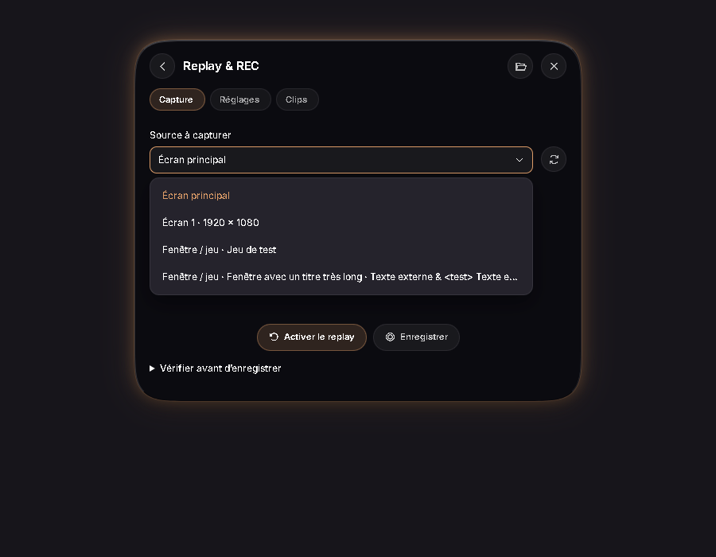

# Bilan du chantier Nolys — 30 octobre 2026

Autorisation : « tu peut tout faire », avec commit préalable. Points de sauvegarde : `4fbe5eb` avant le chantier et `dab82f6` avant la correction supplémentaire du menu Replay. Les fondations React/Tauri/FFmpeg restent identifiées ; aucun SDK MCP n’a été ajouté.

## Corrections des 20 constats

| Constats de l’audit initial | Résultat dans le code | Preuve disponible |
|---|---|---|
| 1 · Volume à zéro | Zéro conservé, requêtes de molette sérialisées, échec signalé. | Tests JS volume et parcours clavier Edge. |
| 2–3 · Démarrage et import invalides | JSON de mauvais type conservé puis remplacé par une valeur sûre ; validation des structures et limites avant import. | Tests de préférences et import invalide dans Edge. |
| 4 · Vue ouverte hors écran | Emprise finale envoyée au natif ; repositionnement et réduction temporaire si nécessaire, sans écraser position/échelle compactes. | Calculs testés sur plusieurs zones, bords et échelles de 65 à 150 % ; parcours des 13 modules. |
| 5–6 · Temps réel et CSP du minuteur | Échéances réelles persistantes, plusieurs minuteurs nommés, chrono séparé, alarmes consommées une fois, écouteurs sans gestionnaire HTML inline. | Tests du modèle, blocage du thread UI et redémarrage simulés dans Edge sous politique de scripts. |
| 7 · Clavier | Tuiles natives, curseurs micro/volume avec ARIA et touches ; Select/contrôles segmentés ; restitution du focus. | Suite Edge d’accessibilité. |
| 8 · HTTP/fond d’écran | Flux borné, échéance totale de 10 s, JSON 1 Mio, images 12 Mio ; limite de décodage/canvas. Verrou de publication court et générations vérifiées après rendu. | Serveur HTTP local volontairement bloqué/surdimensionné, tests de rendu et d’annulation. |
| 9 · Mise à jour | Arrêt commun des services avant installateur ; admissions suspendues, annulation/finalisation attendues, échec récupérable sans relancer de capture. | Tests d’état et de réactivation ; installation réelle distincte. |
| 10 · Échec d’enregistrement | État visible, réessais bornés puis bouton Réessayer ; modifications et suppressions conservées pour la nouvelle tentative. | Tests du stockage et panne disque simulée dans Edge. |
| 11 · Sauvegarde | Format v2 : préférences UI, minuteurs, profils micro, position et paramètres natifs micro/Replay/Fichiers. Préférences lecteur local et historique réappliqués ; récupération et réinitialisation par page. | Tests de validation et de retours arrière indépendants, import/export/récupération Edge. |
| 12 · Confidentialité | Recherche de pochettes désactivable, mode hors ligne, icônes locales, logs de recherche sans titres/URLs ; diagnostic sans données personnelles. | Tests d’images hors ligne et contrôle des champs du diagnostic. |
| 13 · Dépendances | SDK inutilisé/MCP déjà retirés ; patches TLS et Tokio, fonctionnalité ZIP inutile de l’updater retirée. | Audits npm/RustSec et versions verrouillées ; détails dans le document de provenance. |
| 14 · Historique Fichiers | Réparation explicite avec copie de l’original ; aucune publication sur un journal illisible avant réparation. | Tests Rust et parcours de récupération Edge. |
| 15 · Disque/historiques | Cache Replay 128 Mio/512 images ; pochettes 128 Mio avec protection des références ; rétention Fichiers configurable, progression différentielle et consultation des tailles. | Tests de quotas/rétention et de conservation des médias. |
| 16 · Dossiers Cloud | Famille de tags Cloud distinguée des liens/jonctions ; annulation de parcours. | Test de tags et vraie jonction Windows temporaire ; OneDrive réel reste à vérifier. |
| 17 · Clips au-delà de 200 | Index sans troncature, recherche/tri/filtres/pages, sélection multiple, réindexation et relocalisation. | Tests Rust/JS et parcours Edge. |
| 18 · Installeur copié | Les instantanés publics excluent les octets et l’objet privé de mise à jour. | Test de pointeur et sérialisation. |
| 19 · Mesures fictives | Mesures absentes à `null`/« — » ; températures/disque simulés retirés, zéro réel conservé. | Tests Rust/JS et alternance indisponible/zéro/valeur/erreur dans Edge. |
| 20 · Vérification | Commandes communes de contrôle et CI Windows sans publication. | `docs/verification.md` ; aucun passage distant de CI prétendu. |

## Compléments des modules

- Fichiers : sélection native cumulative, liste complète, retrait individuel, réessai limité aux échecs, préférences et dossier de destination.
- Bibliothèque : annulation d’import, publication finale atomique, nettoyage des pochettes orphelines, réparation avec original conservé.
- Replay : vignettes réelles différées, récupération par copie des fragments conservés, aperçu ponctuel et contrôle des niveaux audio uniquement sur action explicite.
- Réglages : guide de première utilisation, profils de traitement par paire micro/sortie, récupération, espace utilisé et export de diagnostic.
- Signalement supplémentaire de l’utilisateur : les listes Replay restent dans la capsule, même avec un titre de fenêtre de plusieurs milliers de caractères ; choix souris/clavier, défilement interne et Échap.

Les sauvegardes exportent des **préférences**, pas les fichiers vidéo/audio ni l’intégralité des bibliothèques et playlists. L’activation du micro n’est pas rétablie automatiquement par un import ou un profil.

## Validation et limites

Passe finale : **77 tests JavaScript**, **82 tests Rust** (6 ignorés par défaut), **build Vite** et **7 suites Edge** réussis. Détail dans le suivi du chantier. Les tests navigateur utilisent le vrai frontend et un pont natif simulé ; les tests Rust emploient des fixtures temporaires. Les tests synthétiques de remux et de vignette FFmpeg ont aussi été exécutés séparément pendant le chantier. Aucun enregistrement du bureau ou du microphone personnel n’a été effectué.

Restent à exécuter physiquement : DPI mixtes et branchement d’écrans, veille réelle, captures longues avec GPU/audio et débranchement de périphériques, vrais fichiers Cloud, changement/restauration du fond d’écran et installation signée. La CSP du binaire release possède son propre contrôle ; elle n’est pas certifiée par Vite.

Les audits ne détectent plus de vulnérabilité connue npm/RustSec à la date du contrôle. Six avertissements Rust informatifs restent visibles, documentés sans exclusion ; voir [la provenance](dependances-et-provenance.md). Les avertissements de compilation CSS sur `:host-context` sont conservés : ces sélecteurs de Shadow DOM fonctionnent dans la cible Edge/WebView2 testée. Aucun nouvel ignore global n’a été ajouté.

Triage Impeccable : défaut réel de menu Replay corrigé. L’exception ciblée `broken-image` de `src/replay/controller.js` reste justifiée par les vignettes différées, transparentes avant chargement et accompagnées d’une icône de repli. Les ressorts de l’interface sont intentionnels et préservés ; leurs conseils `bounce-easing` ne sont pas masqués comme des régressions.

## Aperçu du menu Replay corrigé

Fixture de test avec titre externe très long, fenêtre de 900 × 700 pixels CSS :

