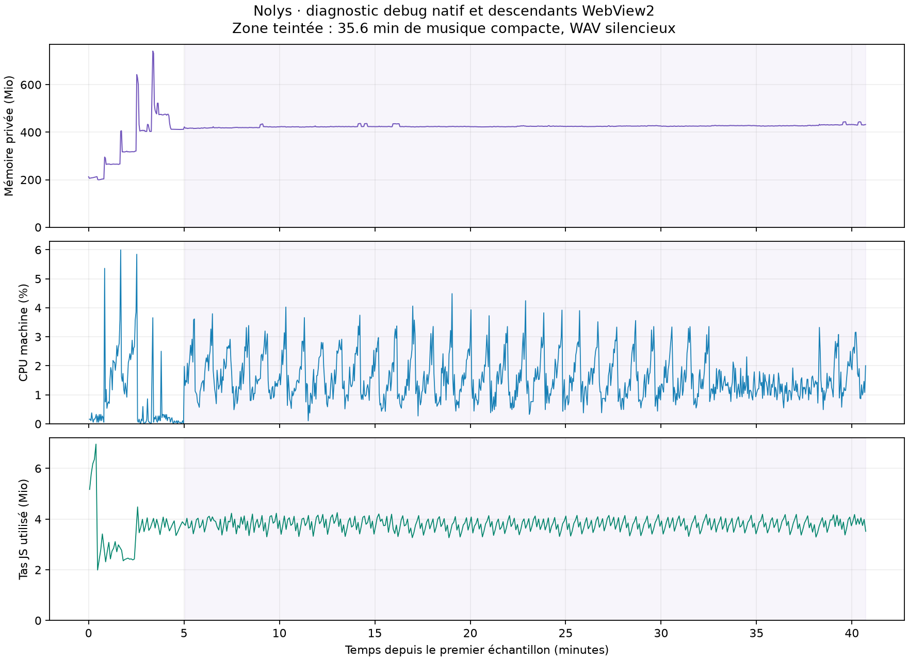

# Mesure native de Nolys

Binaire debug embarqué, SHA-256 `eb0a102d292ac04dbe1517efd84d2996bb441b0920872feae03f30e983386dc0`. 12 processeurs logiques.

Ces valeurs décrivent cette session et cette machine. Le fichier audio est silencieux et muet ; les niveaux audio système des autres applications ne sont pas contrôlés. Elles ne constituent pas une mesure d'une release, d'une capture de jeu ou d'un poste isolé des autres applications.

| État | Durée | Échantillons | CPU machine moyenne | CPU un cœur moyenne | Mémoire privée moyenne | Pic privé |
|---|---:|---:|---:|---:|---:|---:|
| Repos initial | 45 s | 17 | 0.19 % | 2.30 % | 205.6 Mio | 212.8 Mio |
| Musique compacte | 45 s | 16 | 1.84 % | 22.08 % | 265.2 Mio | 266.1 Mio |
| Lecteur ouvert | 45 s | 16 | 2.05 % | 24.62 % | 317.8 Mio | 320.3 Mio |
| Réglages | 45 s | 16 | 0.14 % | 1.70 % | 409.1 Mio | 432.9 Mio |
| Contrôle | 45 s | 17 | 0.34 % | 4.14 % | 481.4 Mio | 522.0 Mio |
| Musique en économie | 45 s | 17 | 0.07 % | 0.83 % | 411.8 Mio | 412.3 Mio |
| Musique · 35.6 min | 2139 s | 888 | 1.59 % | 19.03 % | 424.8 Mio | 443.8 Mio |

Observation arrêtée après 35.6 minutes : finalisation demandée par l’utilisateur avant la fin du test optionnel d’une heure. Le retour final au repos n'a pas été mesuré ; aucune heure complète n'est revendiquée.

100 % CPU « un cœur » correspond à un processeur logique occupé. La colonne machine divise cette valeur par le nombre de processeurs logiques. La mémoire privée additionne le processus natif et ses descendants WebView2 ; le working set, qui partage des pages entre processus, n'est pas assimilé à de la mémoire unique.

## Observation prolongée

La médiane de mémoire privée des dix premières minutes vaut 422.2 Mio ; celle des dix dernières vaut 427.3 Mio, soit +5.1 Mio. Le maximum observé pendant cette phase est 443.8 Mio. Les pics ponctuels et l'évolution des médianes sont présentés séparément.

Le tas JavaScript utilisé va de 3.3 à 4.3 Mio ; le nombre de nœuds DOM va de 144 à 555. Ces compteurs du rendu ne représentent pas la mémoire des textures, des décodeurs et du processus GPU.

GPU : 888 échantillons avec compteur 3D disponible, maximum 0.00 %.
Les compteurs peuvent être arrondis. Ils n'incluent pas la composition du bureau par DWM ; un zéro ne prouve pas l'absence de travail graphique.

## Interprétation et limites

Une hausse pendant une observation limitée ne suffit pas à établir une fuite ; une stabilité sur cette durée ne prouve pas son absence dans tous les scénarios. Les courbes servent à repérer une dérive à investiguer, puis à la relier aux vues et aux processus. La comparaison initial/final inclut le chargement des modules, les caches et les ressources conservées par WebView2.

- Binaire debug embarqué, pas une mesure de la version publiée.
- WAV silencieux local et muet ; les niveaux audio système des autres applications ne sont pas contrôlés.
- Somme de mémoire privée du processus natif et des descendants WebView2.
- Détection média native exécutée ; présentation contrôlée dans la fixture.
- GPU : somme des moteurs 3D des PID concernés, sans composition DWM.
- Transitions exclues des phases stables ; premier delta CPU de chaque nouveau PID non mesuré.
- Observation raccourcie à la demande de l’utilisateur ; retour final au repos non mesuré.

