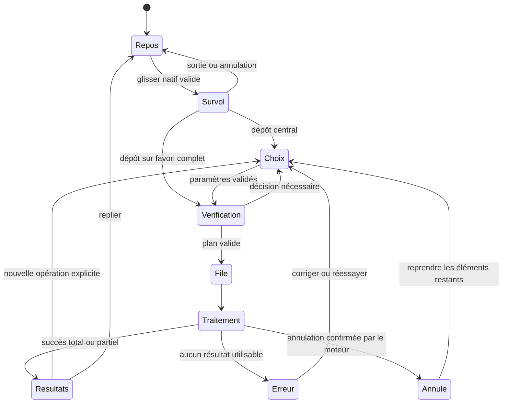

# Nolys — Fichiers dans l'Island

Conception initiale du 18 octobre 2026. **Statut actuel : proposition partiellement implémentée, validation Windows incomplète.** Les sections 1 à 22 conservent l'étude initiale et ses critères comme référence historique ; leurs formulations prospectives ne constituent pas un inventaire actuel des capacités. L'[addendum d'implémentation](#23-addendum-dimplémentation--18-octobre-2026) sépare ce qui existe, ce qui a été observé et ce qui reste à prouver. Les valeurs de temps, de dimensions et de ressources de l'étude sont des points de départ à vérifier sur Windows.

Lecture rapide : [parcours du dépôt](#3-parcours-exact-au-glisser), [capacités](#7-matrice-des-capacités), [sorties et conservation](#11-sorties-originaux-et-conservation), [point technique Windows](#15-intégration-native--le-point-à-prouver-dabord), [architecture](#16-architecture-proposée), [réalisation](#20-ordre-de-réalisation-et-critères-darrêt), [vérification](#21-vérification-requise-pour-limplémentation).

## 1. La décision produit

L'Island devient le lieu où déposer, transformer et récupérer un fichier sans quitter son activité. Nom du module dans l'application : **Fichiers**. Aucun nouveau nom de marque nécessaire.

Le parcours de référence est : **approcher → voir les choix → déposer → suivre → récupérer**. L'utilisateur peut déposer au centre puis choisir tranquillement, ou déposer directement sur une action précise. Le mode rapide complète le mode simple ; aucune touche n'est obligatoire.

L'expérience doit être complète pour chaque action livrée : vrai fichier de sortie, annulation, erreur compréhensible, récupération du résultat et préservation de l'original. Une action non disponible sur la machine n'apparaît pas comme une promesse fonctionnelle.

### Ce que la référence apporte

Sur [Tangerine](https://tangerineformac.com/), les formats, les outils et les actions constituent trois menus distincts. Une touche ouvre ou change le menu pendant le glisser ; le menu reste ouvert après relâchement. La page propose aussi une navigation au clavier. Les traitements de la page sont simulés. Le site annonce des opérations locales sur Mac. Ces observations ne donnent accès ni au code ni aux moteurs de l'application.

Test effectué dans la démo : sélection de `landscape.jpg`, ouverture par Entrée, passage du menu de formats au menu d'outils avec Command, puis au menu d'actions avec Control ; fermeture par Échap. Aucun fichier personnel envoyé.

### Adaptation à Nolys

| Principe | Décision pour Nolys | Raison |
|---|---|---|
| Invocation | Dépôt sur une Island déjà présente | Le point d'entrée existe sur le bureau |
| Choix | Bande de grandes cibles sous la capsule | Compatible avec l'ancrage haut et les bords d'écran |
| Organisation | Convertir, Outils, Actions après dépôt | Même classement pendant le survol et après le dépôt |
| Accès rapide | Favoris explicites, limités à trois | Le geste devient mémorisable |
| Raccourcis | Facultatifs et configurables après validation Windows | Ctrl et Maj ont déjà un sens dans le glisser Windows |
| Traitement | Local pour toutes les opérations de ce module | Pas de transfert de contenu à un convertisseur distant |
| Retour | Résultat dans la même Island, puis dépôt sortant natif | Le fichier reste utilisable dans le flux de travail |

Ne pas reproduire les raccourcis Mac, AirDrop ou toute la liste des formats sans moteur Windows validé. Le menu radial peut être exploré plus tard comme variante ; la première proposition conserve la silhouette et le mouvement de Nolys.

## 2. Ce qui existe réellement

Inspection du dépôt, sans lancer de conversion ni modifier le code applicatif :

| Élément | Constat | Conséquence |
|---|---|---|
| `src/island/dynamic-island/DynamicIsland.js` | Classe assemblée par groupes de fonctionnalités et vues | Ajouter une intégration mince, garder la logique fichiers dans son propre module |
| `features/navigation.js` | Transitions asynchrones ; remplacement du contenu ; une transition en attente | Un glisser ne doit pas dépendre de cette file unique ni perdre sa cible lors d'un rendu |
| `features/events.js` | Clic générique qui ouvre/replie ; gestionnaires musique et placement | Ajouter les exclusions et priorités du module Fichiers |
| `features/notifications.js` | Une notification peut remplacer le mode courant | Protéger la session de dépôt et la configuration d'une opération |
| `src/island/hit-region.js` | Rectangles CSS envoyés au natif avec `devicePixelRatio` | Étendre la collecte aux cibles et à leur état stable |
| `src-tauri/src/island/hit_test.rs` | Clic traversant réévalué toutes les 30/80 ms ; bouton enfoncé pris en compte | Une transaction de glisser native doit coordonner cette logique |
| `src-tauri/src/island/layout.rs` | Fenêtre de base 720 × 600 ; échelle Nolys 0,65 à 1,5 | Les propositions doivent tenir dans cet espace, puis dans la zone de travail réelle |
| `drop-zone.css`, `drop-hub.css` | Styles chargés, avec vortex et grandes tailles ; aucun gestionnaire de fichiers correspondant trouvé dans le code actif inspecté | Les traiter comme héritage visuel, pas comme une fonctionnalité à réactiver aveuglément |
| `src-tauri/Cargo.toml` | `image`, `tempfile`, `rfd`, Windows COM déjà présents | Des briques sont réutilisables ; les conversions PDF et multimédia restent à apporter |
| Bibliothèque | Références aux fichiers audio et sauvegarde atomique | Réutiliser les principes, sans importer automatiquement un fichier audio déposé |
| Thème | Accent cuivre dans `theme-look.js`, apparence personnalisable | Hériter du thème courant, éviter les couleurs néon des anciens styles |

Versions vérifiées dans Cargo.lock : Tauri 2.12.1, Wry 0.57.0, image 0.25.10. Le README n'est pas utilisé pour déduire la version actuelle car certaines indications de version y sont anciennes.

## 3. Parcours exact au glisser

### Entrée et reconnaissance

1. La capsule garde son comportement habituel quand la souris passe sans fichier. Un bouton de souris enfoncé ne suffit pas à identifier un glisser de fichier.
2. Une opération de dépôt reconnue par Windows entre dans la cible de l'Island. La détection garantie de départ porte sur la capsule ; une réaction avant contact n'est pas promise sans cible native dédiée et vérifiée.
3. Retour visuel immédiat : contour et libellé « Déposer un fichier ». Après environ 120 ms de présence, ouverture vers les cibles. Un passage éclair ne déclenche pas de grand panneau.
4. Pendant le survol : utiliser seulement les informations légères disponibles, sans décodage complet, lecture récursive d'un dossier, hydratation cloud ou lancement de moteur.
5. Les actions provisoires déduites d'un nom de fichier restent revalidées après dépôt. Si le type n'est pas connu, montrer « Déposer pour voir les actions ».

### Cibles

La capsule et sa bande d'actions forment une seule zone continue. Le centre signifie toujours « Déposer et choisir ». Les cibles latérales représentent des actions complètes : « PNG », « JPG », « Réduire à 1 920 px », selon les favoris disponibles. « Convertir » seul est un accès au choix du format ; il ne lance pas un résultat arbitraire.

- Au maximum trois cibles rapides, puis le centre ou « Plus » pour le panneau complet.
- Positions stables par famille ; aucune permutation selon la récence au milieu du geste.
- Espaces neutres entre cibles ; si le dépôt ne vise pas clairement une action, ouvrir le panneau de choix.
- Les contours et le texte désignent l'action ; la couleur seule ne suffit pas.
- Dès qu'une cible est engagée, figer sa géométrie et son identité jusqu'à la fin de la session.
- Un agrandissement ne valide pas une cible qui apparaît sous un curseur immobile : il faut une entrée volontaire dans la cible après sa création. Sinon, dépôt central.
- Les favoris nécessitant une décision absente ouvrent la configuration après dépôt. Pas de perte de transparence, animation ou pages silencieuse.

### Dépôt et sortie

Le dépôt crée une sélection enregistrée par le cœur Rust. Au centre : ouverture du panneau. Sur un favori complet : vérification, puis lancement avec ses paramètres visibles dans le résumé. Le curseur Windows doit annoncer une copie/référence, jamais un déplacement de l'original.

Le panneau garde le contexte courant de Nolys pour pouvoir le restaurer. Si la souris quitte les cibles sans déposer, attendre environ 250 ms avant de refermer : traverser un petit espace ou le bord d'une animation ne doit pas annuler le geste. Échap/annulation native nettoie la session immédiatement. Un dépôt ailleurs n'enregistre aucun fichier dans Nolys.

Chaque session porte un identifiant et une génération. Une fin, annulation ou nouvelle entrée invalide les résultats de reconnaissance et les temporisations de l'ancienne session.

## 4. Panneau après dépôt

Mode de visite : **Operate**. Le besoin principal est de terminer une action ; les effets servent la compréhension du geste.

Structure proposée, dans l'Island :

1. En-tête : flèche retour, « Fichiers », nombre sélectionné, fermeture.
2. Résumé : miniature ou icône, nom, type, taille ; détails sur demande. Plusieurs fichiers : pile et total, puis liste accessible.
3. Onglets « Convertir », « Outils », « Actions », avec mémorisation par famille après dépôt uniquement.
4. Deux à quatre choix prioritaires, puis accès aux autres actions réellement compatibles.
5. Paramètres révélés à la demande et destination visible avant lancement.
6. Commande explicite : « Convertir en PNG », « Compresser 8 images », « Extraire 3 pages ».
7. Zone de résultat/activité, accessible sans rouvrir un sélecteur de fichiers.

Dimensions initiales à tester à l'échelle 1 : bande rapide autour de 440 × 150 px ; panneau simple autour de 480 × 320 ; outils détaillés jusqu'à 640 × 480. Ces dimensions sont plafonnées par la fenêtre et l'espace réellement visible, y compris le décalage haut de la capsule. Sur espace réduit, afficher moins de colonnes et faire défiler l'intérieur.

L'ancre de l'Island reste visuellement en place pendant le glisser. À droite ou à gauche, rabattre le panneau dans l'espace disponible. Le halo décoratif ne constitue pas une cible. Les noms longs s'abrègent visuellement, mais restent lisibles dans les détails et par le lecteur d'écran. Aucun nom de fichier injecté comme HTML.

## 5. Apparence, mouvement et accessibilité

L'autorité visuelle est l'interface Nolys existante : capsule, verre teinté, icônes et thème sauvegardé. La capture `docs/screenshots/21-reglages-general.png` a été consultée et rapprochée des accents actuels du code ; ce n'est pas une maquette du nouveau module.

- Apparition des cibles : 160–220 ms ; ouverture complète : 220–300 ms à ajuster au ressort existant.
- Éviter la séquence actuelle qui vide le contenu pendant la transition pour le survol de dépôt : les cibles et leur hit test doivent rester continus.
- Survol d'une cible : contour, contraste et libellé actualisés ; pas de cible qui grossit et repousse ses voisines.
- Traitement : progression vraie si mesurable, indicateur indéterminé sinon. Pas de pourcentage inventé.
- Fin : coche discrète et bilan ; le résultat demeure accessible après la fin de l'animation.
- Réutiliser les niveaux Sobre/Fluide/Vivante, `prefers-reduced-motion` et le mode économie. Aucune boucle de vortex permanente.
- Pas de son par défaut pour chaque dépôt ; option commune au module et respect du mode Focus.
- Cibles d'au moins 44 px dans les vues ouvertes, focus visible, contrastes contrôlés sur verre clair et foncé.
- Parcours clavier complet : menu Fichiers → Ajouter → choix natif ; Tab/flèches ; Entrée ; Échap revient d'un niveau. Fermer une vue ne supprime pas une sortie.
- Lecteur d'écran : état résumé dans une région d'annonce, erreurs annoncées une fois, progression limitée aux changements significatifs.
- Infobulles disponibles au focus ; paramètres décrits autrement que par leur icône ; zoom Windows et texte agrandi vérifiés.
- Interfaces et erreurs françaises ; identifiants d'actions indépendants de la traduction.

## 6. États et priorités

L'état de l'interface est distinct de l'état des traitements. Le travail continue quand la vue se ferme ou que l'Island est masquée.



États supplémentaires des éléments : inspection, indisponible, ignoré, en attente, en cours, réussi, échoué, annulé, interrompu. Un lot partiel n'affiche jamais une réussite totale.

Priorités pendant une session : annulation native/arrêt de l'app → sélecteur ou dialogue en cours → glisser entrant/sortant → configuration fichiers → navigation ordinaire → notification passive. La lecture audio et le minuteur continuent dans tous ces états.

Ne pas utiliser une seule variable `mode` comme source de vérité des fichiers. Garder le mode précédent, le brouillon, la sélection et les résultats dans un store propre. Le glisser est un état transitoire au-dessus de la vue. Une notification différée ne doit pas restaurer ensuite un ancien écran par-dessus un choix plus récent de l'utilisateur.

## 7. Matrice des capacités

**Socle** : première livraison utilisable. **Extension** : étape séparée avec moteur et tests dédiés. Rien de cette matrice n'est annoncé comme déjà implémenté.

| Famille | Socle proposé | Extension | Limite importante |
|---|---|---|---|
| Images statiques | Lire JPG/JPEG, PNG, WebP, BMP ; convertir entre ces formats ; redimensionner ; JPEG qualité réglable | Optimisation PNG, WebP avec perte, recadrage, métadonnées | Les formats activés aujourd'hui dans Cargo ne prouvent pas les garanties de couleur/métadonnées du futur module |
| GIF/WebP animés | Détecter l'animation ; actions générales | Conversion animée par moteur dédié ; export explicite d'une image | Jamais réduire silencieusement à la première image |
| HEIC/AVIF/TIFF/SVG/RAW | Actions générales et explication de l'absence de conversion | Activation format par format | HEIC/RAW/colorimétrie et SVG demandent des traitements spécifiques |
| PDF | Actions générales | Fusion, séparation, sélection/rotation des pages, images vers PDF, PDF vers images | PDF vers Word/Excel fidèle et OCR sont des projets distincts |
| Audio | Actions générales ; ajout explicite à la bibliothèque si compatible | Conversion, extraction, compression, découpe | Codec et conteneur identifiés séparément ; pas de lecture automatique |
| Vidéo | Actions générales | Extraction audio, MP4, réduction taille/résolution, découpe | Sous-titres, rotation, HDR, pistes et accélération matérielle à traiter explicitement |
| Dossiers | Copie vers une destination choisie ; informations | ZIP et import audio explicite | Pas de scan récursif au simple survol |
| Archives | Actions générales | Création ZIP puis extraction protégée | Pas d'exécution de fichiers ; limites d'extraction et de chemins |
| Documents/tableurs/slides | Actions générales | Passerelles de conversion évaluées séparément | Ne pas exiger Office ou LibreOffice sans l'afficher |
| SRT/VTT | Actions générales | Conversion texte dédiée | Encodages et temps validés |
| Type inconnu | Copier les fichiers, copier les chemins, révéler | Nouvelles capacités enregistrées par moteur | Le fichier demeure utile même sans conversion |

Le socle comprend aussi les lots, le suivi, les destinations, le dépôt sortant et les erreurs. Il ne se résume pas à quelques boutons de conversion.

### Les trois familles d'actions

- **Convertir** : choix d'un format de sortie, avec variantes pertinentes et paramètres compatibles.
- **Outils** : transformer sans nécessairement changer de format, par exemple redimensionner ou régler la qualité JPEG.
- **Actions** : copier les vrais fichiers dans le presse-papiers Windows, copier leurs chemins, enregistrer/copier vers un dossier, afficher dans l'Explorateur, mettre de côté, ajouter explicitement à la bibliothèque.

« Ouvrir » n'est proposé directement que pour des catégories documentaires connues ; les exécutables, scripts et raccourcis reçoivent des actions de gestion sans lancement. Un dossier n'est pas traité comme une image, une URL n'est pas téléchargée automatiquement, une vidéo n'est pas importée comme musique.

Le déplacement des originaux et l'ouverture d'un terminal restent hors du socle ; ils pourront être ajoutés comme actions explicites séparées. Les touches Ctrl/Maj ne changent jamais une conversion en déplacement d'original.

## 8. Paramètres par opération

### Images

Choix du format puis, seulement si applicable : qualité, dimensions, transparence, métadonnées. Paramètres initiaux recommandés : JPG qualité 85, redimensionnement au plus à la taille choisie sans agrandissement, conservation des proportions. « 1 920 px » signifie grand côté maximal 1 920 px et se lit ainsi dans le résumé.

- JPG supprime la transparence : afficher le fond choisi, blanc par défaut, et requérir ce choix explicite la première fois ou dans un favori enregistré. Sans ce paramètre, le dépôt rapide ouvre le panneau.
- Préserver visuellement l'orientation EXIF ; si les pixels sont réorientés, réécrire/supprimer le tag d'orientation pour ne pas appliquer deux rotations.
- Métadonnées : par défaut, retirer les métadonnées personnelles dans la nouvelle copie ; proposer leur conservation si le moteur le garantit. L'orientation et le profil couleur sont des besoins de rendu distincts des données GPS.
- Profils couleur, images CMJN/16 bits/HDR : convertir par un chemin validé ou afficher une incompatibilité. Ne pas supposer qu'un simple décodage produit un sRGB fidèle.
- La version actuelle de `image` encode WebP sans perte ; **aucun curseur de qualité WebP** avant ajout d'un encodeur approprié. Voir [WebPEncoder 0.25.10](https://docs.rs/image/0.25.10/image/codecs/webp/struct.WebPEncoder.html).
- Une conversion en PNG n'est pas une promesse de compression. Une opération « Réduire le poids » vérifie le résultat ; si le fichier est plus gros, le dire et ne pas présenter un gain négatif comme un succès.
- Éviter un réencodage avec perte inutile du même format ; l'utilisateur voit quand il modifie qualité ou dimensions.
- Options de recadrage futures : ratios prédéfinis et zone modifiable après dépôt, pas de mini-éditeur à viser pendant un glisser.

### PDF, extension

Avant lancement : nombre de pages, ordre des documents, plage de pages et destination. Ordre par défaut déterministe et réordonnable ; ne pas attribuer un ordre intentionnel à une sélection Windows. Export d'images page par page, nommées et regroupées dans un dossier ; choix de résolution avec estimation mémoire.

Un PDF chiffré demande son mot de passe localement, sans persistance ni journalisation. Les signatures, formulaires, liens, annotations, pièces jointes et couches texte doivent figurer dans les garanties testées de chaque opération. Modifier un document signé peut invalider sa signature : l'indiquer dans son aperçu d'opération. La réduction du poids peut être sans gain ; ne pas promettre un pourcentage.

### Audio/vidéo, extension

Choisir format, profil et pistes. Audio : débit ou mode qualité, canaux et fréquence selon le moteur. Vidéo : conserver la résolution par défaut, profils plus petits explicites, pas d'agrandissement. Conserver les sous-titres/pistes compatibles ou demander comment traiter celles qui ne le sont pas. « Sans réencodage » et « Conversion » ne portent pas la même promesse de vitesse ou précision de coupe.

Afficher ce qui est perdu si une vidéo devient un audio ou une animation devient une image. Pour une taille cible, afficher une estimation puis le poids mesuré ; une cible ne garantit pas un poids exact. L'estimation tient compte de l'audio et de la durée, pas uniquement de la résolution.

## 9. Lots, sélections mixtes et dossiers

- Même famille : proposer les actions communes ; paramètres par défaut communs, erreurs par élément.
- Familles différentes : actions générales en premier, puis groupes « 6 images », « 2 PDF », « 1 audio » ; indiquer exactement le sous-ensemble concerné.
- Jamais ignorer silencieusement les incompatibles. Exemple : « Convertir 6 images — 3 autres fichiers resteront inchangés ».
- Favori rapide sur lot mixte : ne pas lancer le sous-ensemble à l'aveugle ; ouvrir le choix avec la couverture de l'action.
- Doublons : normaliser les chemins Windows, puis utiliser l'identité fichier quand disponible ; le nom seul ne suffit pas. Préserver l'ordre affiché et montrer le nombre de doublons retirés.
- Dossier : choix explicite « Parcourir les fichiers du dossier » ; scan interruptible après dépôt, limites de profondeur et de nombre, pas de suivi des jonctions/symlinks par défaut. Une simple copie de dossier garde sa sémantique de copie.
- Dépôt d'un dossier et d'un de ses descendants : éviter les doublons avant opération récursive.
- Nouvelle sélection pendant un traitement : nouveau lot en attente, jamais substitution des entrées du travail en cours.
- Ajout à un brouillon : bouton « Ajouter » ou zone dédiée ; le dépôt ne fusionne pas implicitement deux opérations distinctes.
- Valeurs initiales à éprouver : 100 éléments dans une sélection simple, 1 000 fichiers pour une exploration de dossier après choix explicite. Au-delà, conserver la sélection initiale et expliquer la limite, sans tronquer silencieusement.
- La liste affiche un aperçu limité puis virtualise/pagine ; les milliers d'éléments ne sont pas rendus à chaque progression.

## 10. Origine des fichiers et cas Windows

| Source/cas | Comportement attendu |
|---|---|
| Explorateur, Bureau, disque local | Chemins natifs acceptés et vérifiés après dépôt |
| Noms accentués, emoji, chemins longs, chemins UNC | Traitement Unicode ; aucune concaténation de commande shell ; erreur explicite si un moteur refuse |
| OneDrive et équivalents | Reconnaître si possible le caractère distant ; pas de lecture au survol ; préciser qu'ouvrir le fichier peut provoquer sa récupération par Windows |
| Réseau ou disque amovible | Vérifier disponibilité au lancement ; annulation/erreur récupérable si déconnexion |
| Pièce jointe Outlook/objet virtuel | Le socle n'annonce pas la prise en charge ; « Enregistrez le fichier puis déposez-le » ; futur adaptateur FILEDESCRIPTOR/FILECONTENTS |
| Image glissée d'une page Web | Pas d'URL traitée comme fichier local ; support futur d'un objet binaire par adaptateur explicite |
| Fichier occupé ou modifié | Erreur par élément ; revalider identité, taille et date au lancement ; demander une nouvelle inspection si les hypothèses ont changé |
| Application source exécutée en administrateur | Tester le refus dû aux niveaux d'intégrité Windows ; proposer le sélecteur au lieu d'élever Nolys |
| Raccourci, exécutable, périphérique spécial | Aucune exécution ni suivi implicite vers une cible |
| Type/extension contradictoires | Inspecter la signature et faire prévaloir le décodeur ; ne pas se fier au suffixe |
| Fichier vide ou endommagé | Actions générales possibles ; erreur claire pour la conversion |

La prise en charge complète d'objets virtuels exige un adaptateur dédié. Microsoft distingue les chemins CF_HDROP des contenus virtuels dans sa [documentation Shell](https://learn.microsoft.com/en-us/windows/win32/shell/dataobject). Ne pas matérialiser le contenu lourd pendant DragEnter/DragOver.

## 11. Sorties, originaux et conservation

### Destination par défaut

Proposition : dossier stable `Documents\Nolys\Exports`, résolu par l'API de dossier connu Windows, puis sous-dossier par lot. Si Documents est redirigé/synchronisé, l'indiquer et permettre un dossier local choisi ; ne pas confondre traitement local et absence de synchronisation par un autre logiciel.

Autres choix : à côté de l'original, dossier personnalisé, demander à chaque fois. La destination effective apparaît dans le résumé. Un dépôt rapide utilise seulement une destination déjà valide ; sinon il ouvre la configuration. Aucun repli silencieux vers un autre dossier si l'écriture est interdite.

Nom : `photo.png` pour un changement de format ; `photo-compressee.jpg`, `photo-1920.jpg` pour une transformation de même format. Collision : suffixe `(2)`, `(3)` avec réservation atomique, y compris si deux lots finissent simultanément. Aucun écrasement par défaut. Une future option de remplacement des originaux demandera un flux séparé ; elle n'est pas activée par ce module.

### Écriture

Écrire dans un temporaire sur le volume de destination, valider la sortie puis la publier avec une opération qui échoue si le nom est déjà pris. Un simple « existe ? puis renommer » ne suffit pas. Ne pas promettre les mêmes garanties atomiques sur tous les partages réseau : vérifier l'implémentation et conserver les erreurs.

L'original est uniquement lu. Vérifier que la sortie ne désigne pas le même fichier par alias, lien ou différence de casse. Contrôle de l'espace libre avant lancement, puis gestion d'un disque rempli pendant l'écriture. Les fichiers terminés demeurent en place après un échec d'un autre élément.

### Durée de vie

- Les exports publiés sont des fichiers utilisateur durables ; aucun nettoyage automatique ne les efface.
- Le tiroir « De côté » conserve des références aux originaux, avec badge « Référence » ; il ne protège pas un fichier contre un déplacement externe.
- Historique proposé : 30 jours ou 100 lots, avec option désactivée ; sa purge enlève des entrées d'historique et des aperçus, pas les exports.
- Les temporaires incomplets appartiennent à Nolys, dans un espace par travail ; nettoyage après arrêt effectif du moteur, puis récupération au prochain démarrage des seuls orphelins identifiés.
- Une migration/une désinstallation ne doit pas traiter le dossier Exports comme un cache.
- Pas de bouton « Annuler » qui supprime une sortie déjà publiée. « Annuler » arrête les éléments non terminés ; « Retirer de la liste » retire seulement une référence. Une suppression future explicite passe par la Corbeille et reste séparée.

## 12. Récupérer et réutiliser

Un résultat montre le nom, le format, le poids réel, et le gain quand il est pertinent. Exemple de données fictives : `capture.webp`, `1,8 Mo → 620 Ko`, « 66 % plus léger ». Pour un lot : « 7 réussis · 1 échec » et détails par fichier.

Actions : « Afficher dans l'Explorateur », « Copier les fichiers », « Enregistrer une copie… », « Glisser le résultat ». Copier les fichiers utilise les formats de presse-papiers du Shell ; copier un chemin reste une commande distincte.

Le dépôt sortant est un vrai glisser Windows portant des fichiers existants. Une URL `blob:`, du texte ou un lien vers le WebView n'est pas un résultat de fichier natif. L'Island reste ouverte pendant le glisser sortant et ne réaccepte pas sa propre session ; les aperçus et résultats ne sont pas nettoyés pendant le transfert. Si la cible déplace un résultat, marquer le chemin indisponible et proposer de le retrouver/recréer selon les entrées.

Accès par menu Fichiers, badge de travail en cours et historique. Un succès peut revenir à la pilule après environ quatre secondes hors interaction ; les résultats demeurent dans le tiroir. Ni le survol/focus utilisateur ni une erreur non lue ne sont fermés automatiquement.

## 13. Traitements, progression et annulation

Service Rust indépendant de la vue. États d'un travail : inspection → validation → en attente → exécution → publication → terminé/partiel/échoué/annulé/interrompu.

- Requête idempotente par identifiant d'opération ; double clic ou répétition d'événement ne crée pas deux exports.
- Démarrer modestement : un traitement lourd à la fois ; au plus deux petites tâches image seulement sous budget mémoire. Un sémaphore compte les ressources, pas seulement les fichiers.
- Budgets initiaux de protection à calibrer : 64 mégapixels et 256 Mio de tampon décodé par image, enveloppe de travail estimée de 512 Mio pour les opérations natives ; un temporaire disque ne résout pas une explosion mémoire au décodage.
- Au-delà : explication « Image trop grande pour cette opération » ou chemin spécialisé ; pas de downscale destructeur caché. Vérifier limites de décodeur et allocations intermédiaires.
- `spawn_blocking` pour l'I/O/CPU approprié ; moteur externe supervisé pour les opérations lourdes. Éviter de bloquer l'événement COM ou le thread de rendu.
- La progression Rust est la référence ; événements limités à environ 5–10/s, identifiant et numéro de séquence ; le frontend peut demander un snapshot après remontage.
- Afficher étapes et nombre traité ; pourcentage seulement si le moteur fournit une mesure pertinente. ETA après échantillons fiables, sinon aucune.
- Annulation : retirer la file immédiatement, signaler au moteur, attendre son arrêt, libérer les ressources et nettoyer ses temporaires. Un `JoinHandle` abandonné ou une promesse JS interrompue n'arrête pas un décodeur.
- Encodage natif indivisible : « Annulation en cours » jusqu'au point sûr ; si le temps maximal d'arrêt est inacceptable, exécuter ce moteur dans un processus isolé.
- Processus externes : groupe/Job Object Windows, arrêt des enfants, délais et journal borné ; pas de console fugitive.
- Pas de « Pause » dans le socle ; suspendre un FFmpeg arbitrairement n'est pas une capacité démontrée. On peut différer les prochains travaux.
- Veille/session verrouillée : les travaux déjà lancés suivent les possibilités OS ; à la reprise, revalider les fichiers. Ne pas promettre une progression pendant le sommeil.
- Fermeture réelle de Nolys pendant un travail : proposer quitter et annuler, ou rester ouvert ; masquer l'Island conserve le traitement. Mise à jour : attendre la fin ou obtenir une annulation explicite.
- Après crash : travaux actifs marqués « Interrompus », sorties publiées conservées, temporaires incomplets non présentés comme résultats. Reprise par nouvelle validation, jamais relancement automatique d'une opération sensible.

## 14. Cohabitation avec les modules Nolys

| Situation | Règle |
|---|---|
| Musique en lecture | Continue ; aucune source/piste/volume modifié par le dépôt |
| Bibliothèque ouverte | Maintenir le contexte ; proposer l'import audio explicitement après dépôt |
| Réglages avec saisie en cours | Petit accueil au-dessus, sans démonter le formulaire ; stocker/restaurer le brouillon |
| Dialogue natif ouvert | Suspendre l'accueil de dépôt concurrent ; la perte de focus ne replie pas l'Island |
| Notification passive | Différer/coalescer sans remplacer les cibles ni voler le focus |
| Minuteur terminé | Signal discret ; alerte persistante consultable sans déplacer la cible active |
| Mode Focus | Un dépôt intentionnel reste utilisable ; aucune notification passive ajoutée |
| Mode économie | Effets minimaux ; activité native limitée ; pas de polling global supplémentaire permanent |
| Mode placement | Aucun dépôt fichiers pendant le déplacement de l'Island ; action indisponible clairement |
| Plein écran | Respecter le masquage configuré ; pas de réapparition parce qu'un bouton de souris est enfoncé |
| Island masquée manuellement | Reste masquée ; accès par les moyens existants, puis menu Fichiers |
| Second écran | Le point de dépôt reste sur l'écran configuré ; ne pas téléporter l'Island sous le curseur |
| Changement de DPI/écran débranché | Invalider les cibles devenues fausses ; restaurer une géométrie sûre, sans valider une action décalée |

Créer une garde de présentation pendant glisser/configuration/dialogue, et des jetons de génération pour les retours asynchrones. Ne pas réutiliser une file de notifications à une seule entrée pour transporter des lots.

## 15. Intégration native : le point à prouver d'abord

### Constat vérifié dans les versions locales

Dans Wry 0.57.0, `src/webview2/drag_drop.rs`, DragEnter récupère CF_HDROP et choisit l'effet copie. DragOver relaie la position mais réutilise l'effet mémorisé. Le callback public de Tauri est un flux d'événements, pas une fonction d'acceptation par cible DOM. Voir le [code Wry de cette version](https://github.com/tauri-apps/wry/blob/wry-v0.57.0/src/webview2/drag_drop.rs) et [onDragDropEvent](https://v2.tauri.app/reference/javascript/api/namespacewebviewwindow/#ondragdropevent).

Le gestionnaire de Tauri 2.12.1 autorise aussi les chemins reçus à son scope de fichiers lors du dépôt ; la branche fenêtre peut autoriser récursivement un dossier. Cela ne remplace pas l'autorisation métier des travaux Nolys et mérite d'être évité si l'on choisit un adaptateur propre.

Un écouteur DOM `dragover`/`drop` ajouté seul ne résout pas l'intégration : Tauri remplace le gestionnaire de WebView2. Sa [documentation](https://docs.rs/tauri/latest/tauri/webview/struct.WebviewWindowBuilder.html#method.disable_drag_drop_handler) expose le désarmement du gestionnaire natif pour utiliser le HTML5 sous Windows. Ce réglage est à choisir explicitement dans le builder Rust actuel, car les fenêtres sont créées dynamiquement.

### Contrat exigé

1. Hors de la capsule et des cibles effectivement visibles, Nolys ne reçoit ni ne détourne un dépôt destiné à l'application derrière.
2. Curseur natif cohérent : effet accepté seulement pour une vraie cible, aucun effet de déplacement d'original.
3. Coordonnées fiables aux DPI mixtes et à l'échelle Nolys ; suivi continu pendant l'expansion.
4. Entrée, sortie, Échap, dépôt avant fin d'animation et glisser sortant nettoient toujours la session.
5. Aucun focus volé pendant le glisser ; aucune ouverture de fichier à la place d'un dépôt.

Retourner `DROPEFFECT_NONE` sur une grande fenêtre n'achemine pas automatiquement le dépôt à l'application dessous : le refus et le passage à travers sont deux propriétés différentes. Les deux doivent être démontrées.

### Décision d'implémentation proposée

Commencer par un prototype natif minimal avec de vrais fichiers, sans convertisseur. Comparer l'accueil Tauri actuel sur la géométrie effective à un adaptateur Windows maîtrisé. Le code inspecté justifie de prévoir l'adaptateur OLE comme solution de production si l'accueil Tauri ne respecte pas le contrat.

L'adaptateur possède sa cible IDropTarget, ses effets d'acceptation et son cycle de vie COM STA. Il doit viser les HWND réellement destinataires, y compris les enfants WebView2, ou utiliser une petite fenêtre de réception dont la région ne couvre que les cibles. Le choix entre ces stratégies dépend du prototype : pas d'enregistrement concurrent de deux IDropTarget sur le même HWND, ni de confiance dans la transparence visuelle pour définir la zone native.

Si l'adaptateur est retenu : désactiver le gestionnaire Tauri pour cette fenêtre, maîtriser le comportement HTML5 par défaut afin qu'aucun fichier ne navigue dans le WebView, enregistrer/révoquer les cibles sur le bon thread avec leur message loop et leurs durées de vie. Transférer les données lourdes seulement après dépôt et hors des callbacks COM.

L'accueil de proximité, s'il est ajouté, ne s'étend que pendant une session de fichier attestée ; pas d'interception globale de tout glisser Windows. Le socle peut s'activer à l'entrée dans la capsule pour rester fiable.

Pour la sortie, implémenter un IDataObject/IDropSource et [DoDragDrop](https://learn.microsoft.com/en-us/windows/win32/api/ole2/nf-ole2-dodragdrop) sur un contexte OLE adapté, avec vrais chemins de sortie, libération des handles et protection contre la réentrée. La méthode Tauri `startDragging()` existante déplace une fenêtre : elle ne glisse pas des fichiers.

### Coordonnées

À la frontière native, conserver le point écran physique puis convertir avec `ScreenToClient` pour le HWND cible. Convertir vers les coordonnées CSS par le ratio effectivement communiqué par le WebView, qui inclut le zoom de l'Island ; ne pas remultiplier aveuglément DPI écran × échelle Nolys. Pour une fenêtre auxiliaire, convertir d'abord son origine vers celle de la fenêtre Island.

Le snapshot de géométrie inclut rectangles, forme/coins si nécessaire, ratio, origine et génération. Pendant animation, actualiser les cibles de façon contrôlée ; après engagement, conserver les cibles stables ou revenir au choix central. Le cœur vérifie la dernière géométrie au dépôt, pas une cible JS laissée active par un ancien survol. DevTools détachés pour les essais de coordonnées, selon la limitation documentée de Tauri.

## 16. Architecture proposée

```text
Entrée Windows / sélecteur natif
  → adaptateur de dépôt et session native
  → registre d'entrées autorisées (Rust)
  → inspection bornée et registre des capacités
  → plan d'opération validé / paramètres / destination
  → file de travaux et moteurs
  → publication des sorties
  → tiroir, historique, copie et glisser natif sortant
```

### Fichiers et responsabilités

| Chemin proposé | Responsabilité |
|---|---|
| `src/files/store.js` | Sélections, brouillons, jobs, résultats ; indépendant du montage |
| `src/files/controller.js` | Cycle de vie de la vue, événements et commandes |
| `src/files/view.js` | Rendu DOM sûr, états, clavier et annonces |
| `src/files/capabilities.js` | Présentation des capacités reçues du natif ; aucun pouvoir d'autorisation |
| `src/island/dynamic-island/features/file-drop.js` | Accueil transitoire et priorité de présentation |
| `src/island/dynamic-island/views/files.js` | Montage/fermeture du panneau, selon la convention des grandes vues |
| `src/island/styles/files.css` | Styles limités à la nouvelle surface, thème hérité |
| `src-tauri/src/files/mod.rs` | Service et état natif du module |
| `src-tauri/src/files/commands.rs` | Commandes typées, validation et erreurs |
| `src-tauri/src/files/inputs.rs` | Registre d'entrées et inspection |
| `src-tauri/src/files/jobs.rs` | File, concurrence, snapshots, annulation |
| `src-tauri/src/files/output.rs` | Noms, destinations, temporaires, publication et rétention |
| `src-tauri/src/files/engines/` | Images, puis adaptateurs PDF/multimédia séparés |
| `src-tauri/src/platform/file_drag.rs` | Réception et émission natives Windows selon le prototype |

Intégrations à modifier au moment de construire : enregistrement dans `lib.rs`, builder et hit test dans `island/`, wrapper natif dans `shared/ipc.js`, navigation, clic générique, notifications, menu des modules, paramètres et imports CSS. Préférer un contrôleur avec montage/destruction explicites ; ne pas grossir la classe principale avec tous les moteurs.

### Données et API

Modèles principaux : `DropSession`, `InputSelection`, `InputDescriptor`, `ActionCapability`, `OperationPlan`, `FileJob`, `ItemResult`, `OutputDescriptor`. Entrées et sorties exposées à l'interface par identifiants opaques ; les chemins absolus restent détenus et validés par Rust, avec seulement les informations d'affichage utiles.

Commandes proposées, noms à stabiliser avant codage :

| Commande | Contrat |
|---|---|
| `files_pick` | Sélecteur natif → sélection enregistrée, ou annulation distincte d'une erreur |
| `files_inspect` | Inspecte une sélection attestée, pas des chemins arbitraires reçus du JavaScript |
| `files_capabilities` | Capacités effectives des moteurs, limitations et disponibilités |
| `files_plan` | Valide action/entrées/options/destination et retourne un plan avec avertissements |
| `files_start` | Revalide et exécute un plan identifié, avec clé d'idempotence |
| `files_cancel` | Demande l'arrêt ; résultat final annoncé séparément |
| `files_snapshot` | État courant complet et numéro de séquence pour la resynchronisation |
| `files_reveal`, `files_copy`, `files_drag_out` | Agissent sur des identifiants de résultats/entrées détenus par le service |
| `files_history`, `files_forget` | Historique et retrait de références, sans suppression d'exports |

Événements adressés à la fenêtre Island seulement : état de session et activité fichiers. Éviter de faire passer des octets de fichier/base64 dans l'IPC ; utiliser des miniatures bornées et un scope d'assets restreint aux aperçus autorisés. Les capacités Tauri doivent autoriser précisément la fonction choisie, sans shell libre ni scope global de système de fichiers.

La couche de registre relie un dépôt/sélecteur natif attesté à des handles/identités. Les tokens de sélection ne sont pas réutilisables indéfiniment ; un travail actif conserve sa propre référence. Les requêtes d'une autre fenêtre ou un token expiré échouent. Le traitement n'accepte pas un chemin inventé par la vue sous prétexte que `native.invoke` est disponible.

### Persistance et courses asynchrones

Préférences, brouillons récupérables et manifestes de travaux portent une version de schéma. Les écritures du manifeste sont atomiques et sérialisées ; un fichier illisible est conservé avec erreur explicite, jamais remplacé silencieusement par une liste vide. Enregistrer les étapes importantes, pas chaque événement de progression. Les chemins privés restent dans les données locales de Nolys.

Un manifeste de sortie garde l'identifiant du travail, le chemin temporaire détenu par Nolys, le nom final réservé et l'état de publication. Au redémarrage, réconcilier la publication qui a réussi juste avant un crash avec le manifeste qui n'a pas encore enregistré son succès. Ne jamais publier une seconde copie automatiquement, ni effacer une sortie existante sous prétexte que son état est ambigu.

L'annulation et la publication possèdent un ordre défini sous verrou de travail : avant le point de publication, l'annulation empêche la publication ; après ce point, l'élément est terminé et conservé. Le bilan reflète cette course au lieu d'afficher « annulé » sur un fichier déjà exporté. Revalider les entrées lors d'une reprise et la disponibilité des sorties avant copie/glisser.

À chaque montage, s'abonner aux événements puis demander le snapshot ; réconcilier avec les numéros de séquence pour ne pas perdre une fin de travail dans l'intervalle. Un événement ancien ne remplace pas un snapshot récent. Les notifications de rendu sont désabonnées au démontage, le service de travaux continue.

Pour les sélecteurs Windows, reprendre la contrainte COM déjà rencontrée dans `library/commands.rs` : ne pas réutiliser sans vérification un thread de pool initialisé en MTA pour un dialogue nécessitant un contexte STA. Distinguer annulation utilisateur, dialogue en erreur et sélection vide.

## 17. Moteurs et distribution

| Besoin | Proposition | Vérification avant activation |
|---|---|---|
| Images de base | Crate `image` déjà verrouillée, encodeurs explicitement choisis | Qualité, limites mémoire, orientation, couleur et métadonnées |
| PNG plus petit | Évaluer un optimiseur dédié, par exemple oxipng | Gain réel, licence de la version retenue, temps CPU et conservation des propriétés |
| WebP avec perte | Évaluer libwebp et sa liaison Rust | Distribution Windows et profil de qualité ; ne pas prétendre que l'encodeur actuel suffit |
| PDF | Évaluer lopdf pour structure et PDFium pour rendu | Garanties de pages/formulaires/signatures, DLL, licences et validation sur corpus |
| Audio/vidéo | FFmpeg/ffprobe embarqués et versionnés | Codecs réellement présents, taille installateur, consommation et licences de la compilation exacte |
| ZIP | Évaluer une crate Rust dédiée | Chemins, quotas, CRC, interruption et compatibilité Windows |

Ces bibliothèques supplémentaires sont des candidats, pas des dépendances approuvées/présentes dans le projet. Le choix s'arrête après un essai borné avec un corpus représentatif ; ne pas bâtir une couche générique de plugins avant deux moteurs réels.

FFmpeg : exécution depuis Rust par arguments séparés, sans `cmd /c`/PowerShell, sans téléchargement automatique d'un exécutable trouvé dans le PATH. Ne pas utiliser un FFmpeg installé sur ce poste comme preuve du fonctionnement chez tous les utilisateurs. Embarquer un binaire adapté et son inventaire ; Tauri documente l'[embarquement de binaires externes](https://v2.tauri.app/develop/sidecar/).

Conversion locale : restreindre les protocoles/démultiplexeurs pour éviter qu'une playlist reçue comme fichier n'ouvre du réseau. Désactiver l'entrée interactive, superviser progrès et codes de sortie, protéger les logs et les chemins inhabituels. Voir les [protocoles FFmpeg](https://ffmpeg.org/ffmpeg-protocols.html) et la [documentation du programme](https://ffmpeg.org/ffmpeg.html).

Avant distribution, vérifier la configuration exacte des bibliothèques/codecs et joindre leurs notices ; la page [FFmpeg License and Legal Considerations](https://ffmpeg.org/legal.html) explique que les obligations dépendent notamment des composants activés. Ce document ne suppose pas qu'une compilation quelconque convienne à la diffusion de Nolys.

Pour garder l'installateur initial raisonnable, livrer d'abord le socle image ; PDF et multimédia suivent dans des versions identifiées. Un téléchargement facultatif de moteurs est une évolution distincte : source de confiance, version, hash/signature, installabilité hors ligne et état clair dans l'interface. Aucune installation cachée lors d'un premier dépôt.

## 18. Erreurs, sécurité et confidentialité intégrées

L'objectif est un comportement prévisible sur des fichiers réels, y compris mal formés. Aucun envoi de contenu, aucun chargement d'image distante par nom de fichier, aucun moteur cloud implicite.

| Problème | Message proposé | Suite utile |
|---|---|---|
| Source disparue | « Ce fichier a été déplacé ou supprimé. » | Retrouver le fichier |
| Accès refusé | « Nolys ne peut pas lire ce fichier. » | Choisir une autre copie |
| Sortie interdite | « Ce dossier n'autorise pas l'enregistrement. » | Changer de dossier |
| Espace insuffisant | « L'espace disponible ne suffit pas pour terminer. » | Autre destination / réessayer |
| Format non pris en charge | « Les actions de conversion ne sont pas disponibles pour ce format. » | Copier / afficher / autre fichier |
| Fichier corrompu | « Le fichier ne peut pas être décodé. » | Détails techniques repliés |
| Moteur absent | « Cette opération nécessite le moteur vidéo. » | État du module, sans bouton de traitement trompeur |
| Aucun gain | « Ce fichier est déjà aussi léger avec ces réglages. » | Autres réglages ; original préservé |
| Résultat plus grand | « La conversion a réussi ; le fichier est plus volumineux. » | Poids réel, pas de badge de compression |
| Arrêt demandé | « Annulation en cours… » puis bilan réel | Garder les fichiers déjà terminés |
| Lot partiel | « 7 fichiers prêts · 1 échec. » | Réessayer uniquement l'échec après revalidation |

Pas de chemins/noms complets dans les journaux par défaut ; détails locaux sur demande. Mots de passe, contenus et miniatures exclus du diagnostic partagé. Logs de moteurs bornés et expurgés. Le retrait des métadonnées concerne les nouvelles copies et n'est pas une garantie de rendre un document anonyme.

Archives futures : refuser les sorties hors du dossier choisi, chemins absolus, traversées `..`, entrées de type lien et noms Windows problématiques ; quotas de taille décompressée, taux, nombre d'entrées et profondeur. Pas d'extraction automatique de contenu actif. Moteurs PDF/images soumis à des limites de temps, taille et mémoire ; processus séparé quand la robustesse l'exige. Les liens symboliques/jonctions et changements d'identité entre inspection et écriture sont revérifiés.

## 19. Réglages du module

Section Fichiers dans les Réglages existants ; valeurs enregistrées côté service avec schéma versionné, affichées dans l'interface et partagées sans duplication divergente en localStorage.

- Activer l'accueil de fichiers dans l'Island ; réception prévue sur la capsule.
- Destination par défaut et aperçu du chemin effectif.
- Trois favoris rapides par famille, avec paramètres explicites et réinitialisation.
- Qualité JPEG, taille des images et politique de métadonnées ; pas de réglage inapplicable à un moteur.
- Garder les fichiers de côté, durée/nombre d'entrées d'historique et option sans historique.
- Sons et mouvement hérités des préférences globales, surcharge seulement si utile.
- Capacité disponible de chaque moteur et version, dans les détails techniques.
- Concurrence automatique prudente ; options avancées seulement après mesures.

Raccourcis de type Tangerine : évolution facultative après essai OLE. Ne pas intercepter Ctrl/Maj globalement. Le parcours proposé prévoit déjà un accès clavier complet sans glisser via le menu Fichiers et le sélecteur.

## 20. Ordre de réalisation et critères d'arrêt

### Étape A — preuve Windows

Réception d'un fichier, ouverture des cibles, annulation, refus hors cible, DPI mixtes et sortie native d'un fichier de test. Choix documenté de l'adaptateur. **Pas d'étape suivante tant que le bureau ou l'application derrière peut perdre un dépôt.**

Livrable : prototype interne et capture d'un vrai transfert Explorateur → Island → Explorateur, avec vérification du contenu du fichier final. Le site de Tangerine et un mock navigateur ne suffisent pas.

### Étape B — service et cycle de vie

Registre des entrées, sélection, inspection légère puis complète, plans, destinations, collisions, file, annulation, historique et reprise après arrêt. Une simple copie vers Exports permet de valider tout le trajet sans moteur complexe.

### Étape C — socle image complet

Conversions statiques, JPEG qualité, redimensionnement, lots et erreurs ; interface intégrée, thèmes, clavier, glisser sortant et récupération. Mesurer les coûts de premier lancement, puis vérifier musique et clic traversant. C'est la première livraison recommandée.

### Étape D — PDF

Ajouter seulement les opérations dont le moteur garantit le résultat sur les cas documentaires retenus. Fusion/extraire/export images avant OCR ou conversions bureautiques.

### Étape E — audio/vidéo

Embarquement/versionnage du moteur, profils, progrès, annulation de processus, pistes et sorties. Tester la coexistence avec la lecture et le retour micro.

### Étape F — approfondissements

Archives, références virtuelles, outils avancés, favoris clavier, préréglages personnels. Chaque extension ajoute ses capacités réelles à la même interface, sans menus remplis de boutons inactifs.

Pas d'estimation de délai ferme avant la preuve Windows et l'essai des moteurs. Ces deux points dominent l'incertitude, bien plus que le dessin des boutons.

## 21. Vérification requise pour l'implémentation

Les critères suivants sont des essais à effectuer lors de la construction, **pas des tests déjà exécutés par cette étude**.

| ID | Scénario | Résultat nécessaire |
|---|---|---|
| D01 | Passage souris sans fichier, sélection de texte, déplacement d'une fenêtre | Aucun accueil fichiers |
| D02 | Entrée, sortie, retour, Échap, dépôt très rapide | Une seule session, retour propre, aucune action fantôme |
| D03 | Dépôt sur fond transparent à côté/au-dessous, app derrière visible | Le dépôt parvient à sa destination normale |
| D04 | Cible créée sous un curseur immobile pendant l'expansion | Aucune conversion choisie par accident |
| D05 | 100/125/150/200 % Windows, Nolys 0,65/1/1,5 ; écrans à coordonnées négatives | Visuel, cible et point natif concordent |
| D06 | Bord droit/gauche/haut/bas, barre des tâches et petite zone de travail | Contrôles visibles et récupérables |
| D07 | Noms Unicode, très longs, espaces et caractères ressemblant à des arguments | Traitement exact, aucun lancement de commande |
| D08 | Texte/URL/objet virtuel non pris en charge | Aucune lecture réseau ni interprétation erronée |
| F01 | JPG/PNG/WebP/BMP de référence, images orientées et transparentes | Format réel, taille, orientation et rendu validés |
| F02 | Animation, CMJN, ICC, 16 bits/HDR | Préservation garantie ou incompatibilité explicite |
| F03 | Fichier faux/endommagé, dimensions énormes, fichier vide | Erreur bornée ; Island et lecture utilisables |
| F04 | Compression sans gain ou conversion plus grosse | Bilan honnête ; original inchangé |
| F05 | Même nom, casse différente, deux lots simultanés, sortie liée à l'original | Aucun écrasement ni troncature |
| F06 | Lot mixte, doublons, dossier avec lien/descendant et dépassement de quota | Couverture explicite ; scan borné et annulable |
| J01 | Double clic et répétition d'un événement de dépôt | Un seul travail par demande |
| J02 | Annulation avant exécution, pendant encodage et pendant publication | Résultats terminés conservés ; partiels non publiés |
| J03 | Disque plein, fichier verrouillé, réseau déconnecté, source modifiée | Erreur par élément, reprise ciblée |
| J04 | Vue fermée/rouverte, notifications, musique, micro et minuteur | État conservé, son continu, aucune cible déplacée |
| J05 | Crash, redémarrage, veille, mise à jour | Aucune sortie incomplète annoncée ; état interrompu explicite |
| R01 | Glisser résultat vers Explorateur, mail et une app compatible ; annulation | Vrai fichier, aucun auto-dépôt/réimport involontaire |
| R02 | Copier les fichiers puis coller dans Explorateur | Fichiers utilisables, distinct de copier leur chemin |
| R03 | Historique oublié/purgé et cache nettoyé | Exports conservés et récupérables |
| A01 | Clavier seul, Narrateur, texte agrandi, contraste, mouvement réduit | Parcours complet sans glisser et annonces utiles |
| P01 | Lot images avec lecture audio/micro actifs et effets en économie | Pas d'interruption audio attribuable au module ; interface réactive |
| P02 | Installation propre, sans FFmpeg/Office dans PATH | Socle autonome ; extensions honnêtement identifiées |
| X01 | PDF chiffré/signé/formulaire et vidéo multipiste/HDR | Garanties de l'action et pertes éventuelles vérifiées |

Tests automatisés utiles : planification des capacités/lot mixte, normalisation des entrées, réservation concurrente de noms, transitions d'annulation, idempotence et limites de ressources. Essais Windows réels indispensables pour OLE, clic traversant, presse-papiers, focus et DPI. Les tests UI simulés ne valident pas ces points.

Mesures à relever : latence d'accroche, ouverture à froid, mémoire maximale par famille, CPU/latence pendant audio, délai réel d'annulation et poids de l'installateur. Les temps d'animation visés ne sont pas des benchmarks obtenus.

## 22. Décisions arrêtées dans cette proposition et inconnues restantes

**Proposition recommandée :** module Fichiers intégré, cibles sous la capsule, dépôt central rassurant, favoris explicites, traitement local, originaux préservés, sorties durables, file indépendante de la vue, récupération native et extensions par moteurs réels.

**À trancher par preuve technique :** accueil Tauri conservable ou adaptateur OLE ; HWND/région de réception ; garantie du dépôt hors cible ; fiabilité des coordonnées aux DPI mixtes ; comportement du glisser sortant pendant la boucle OLE ; corpus couleur/metadata des images ; choix et distribution des moteurs PDF/vidéo ; budgets matériels.

**À ajuster après usage :** taille des cibles, délai d'accroche, favoris par défaut, niveau de détails et destination préférée. Ces réglages n'empêchent pas le prototype ; ils ne justifient pas de prétendre que les inconnues natives sont résolues.

Lors de la phase d'étude initiale, seuls le code, la capture existante et la démo Web avaient été consultés : aucun prototype OLE ni moteur nouveau n'avait encore été exécuté ou compilé, et le code applicatif et les dépendances étaient alors inchangés. Ce constat historique est désormais complété par les modifications et les essais ci-dessous.

## 23. Addendum d'implémentation — 18 octobre 2026

Cet addendum décrit l'état ultérieur du dépôt et les preuves recueillies pendant l'implémentation. Il ne remplace ni la feuille de route ni les critères des sections 20 et 21. **Le module complet n'est pas prêt pour diffusion ; les étapes A et C restent ouvertes.**

### Capacités présentes dans le dépôt

- Moteur local d'images statiques : lecture et sortie JPG/JPEG, PNG, WebP sans perte et BMP ; redimensionnement proportionnel sans agrandissement ; qualité/compression JPG. Les animations PNG/WebP, profondeurs de couleur non prises en charge et JPEG CMJN/YCCK sont refusés explicitement. La lecture source est bornée à 128 Mio avant construction des décodeurs, y compris ceux qui lisent tout le flux dans leur constructeur. Les limites de décodage restent 64 mégapixels, 16 384 px par côté et 256 Mio d'allocation configurée ; ce ne sont pas des mesures de mémoire totale du processus.
- Les images RGBA entièrement opaques deviennent JPG sans choix de fond ; la transparence réelle exige un fond explicite. L'orientation est appliquée et seuls les profils ICC RVB compatibles sont conservés : en-tête vérifié, taille au plus 4 Mio ; les autres espaces ICC sont refusés explicitement. BMP est refusé si le profil ne peut y être conservé. Ces contrôles ne valident pas le corpus complet couleur/métadonnées.
- Copie de fichiers ordinaires, y compris sans moteur de transformation, vers un dossier Exports durable. Les originaux restent intacts ; les sorties passent par un temporaire et une publication atomique sans écrasement. La copie récursive des dossiers n'est pas livrée.
- File de travaux native, résultats par élément, annulation, historique persistant, retrait d'une entrée sans suppression de son export et marquage des travaux actifs comme interrompus au redémarrage. La reprise ciblée des échecs et la rétention configurable de l'historique ne sont pas implémentées.
- Remplacer une sélection libère les anciens identifiants non nécessaires aux travaux en attente, sans perdre les sources de ces travaux. Le worker intercepte une panique de traitement, enregistre l'échec et continue avec le travail suivant.
- Quitter refuse les nouvelles sélections/demandes, désactive la réception entrante et demande l'annulation de tous les travaux. Le drainage du worker fichiers attend jusqu'à trois secondes, puis les travaux non terminés restent interrompus au redémarrage. Le test unitaire vérifie refus des demandes tardives et annulation ; il ne mesure ni le drainage physique ni la durée totale de fermeture de Nolys.
- Sélecteur natif, accès par menu Fichiers et Ctrl+Alt+F, réception OLE Windows, copie de vrais fichiers dans le presse-papiers et adaptateur de glisser sortant. La présence de ces adaptateurs ne vaut pas validation de chaque parcours natif.
- Aucune transformation PDF, audio, vidéo ou archive ; aucune préférence Fichiers dédiée livrée. Ces éléments restent dans la feuille de route, sans promesse de disponibilité actuelle.

Les fichiers effectivement présents sont notamment `src/files/controller.js`, `src/files/store.js`, `src/files/styles.css`, `src/island/dynamic-island/views/files.js` et `src-tauri/src/files/{mod,model,commands,images,drag}.rs`. Ils remplacent la simple hypothèse de composants à construire. Le code applicatif, Cargo.toml et Cargo.lock ont évolué depuis l'étude. `zune-core` et `zune-jpeg`, déjà présents dans le lockfile, sont désormais des dépendances directes pour vérifier l'espace couleur des en-têtes JPEG.

### Continuité avec l'interface Nolys

Il s'agit d'une extension du système existant. `src/files/controller.js` monte `createPanel` de la Bibliothèque, réutilise son en-tête `round-btn`, ses actions `pill-btn` et ses onglets `chip`. `src/files/styles.css` ajoute la disposition propre aux fichiers aux styles partagés de `src/library/styles.css` : typographie Inter, accent issu du thème, surfaces de verre, texte, bordures et ressorts existants.

`src/island/dynamic-island/views/files.js` emploie `transitionState`, `capsuleSettled`, `afterIntro` et `fitPanel` ; la surface utilise la scène de verre commune et le thème défini par `src/shared/theme-look.js`. L'accueil reprend les animations Nolys et les réglages globaux de mouvement, dont la réduction des animations. La demande de réutiliser l'UX et les animations de l'application s'applique à l'ensemble du module. Aucun nouveau monde visuel ni système de design autonome n'est établi par cet addendum.

La dernière modification fonctionnelle du bouton « Glisser » lance `dragOut` dès l'appui gauche (`pointerdown`), sans attendre un déplacement DOM ; Windows prend ensuite en charge mouvement et annulation. La comparaison avec l'interface existante reste valable : ce changement d'événement ne modifie ni les composants, ni la disposition, ni les styles et animations décrits ci-dessus.

La revue de finition, limitée à l'intégration visuelle capturée, a confirmé la continuité de marque et n'a relevé aucun défaut visuel matériel dans `.impeccable/review/files-empty-results.png` : capture réelle de 720 × 570 contenant un résultat. Cette disposition ne valide ni le clic traversant, ni les performances, ni la totalité des états du module. La correction documentaire de cette revue a mis à jour PRODUCT.md, qui indiquait encore à tort qu'aucun traitement n'était implémenté.

Une correction UI ultérieure supprime le fond blanc par défaut du bouton Fichiers du menu (`appearance`, fond transparent et remise à zéro du padding). `src/island/styles/files.css` laisse ensuite agir les tuiles, icônes, libellés et survols existants de `notification-menu.css`. La capture réelle `.impeccable/review/files-menu.png` montre Fichiers dans la même grille et le même verre que les autres modules ; cette correction reste dans le système visuel Nolys.

### Preuves et portée de validation

| Vérification | Résultat consigné | Portée et limites |
|---|---|---|
| Compilation et tests | Sur les dernières sources : `npm run build:ui` terminé avec code 0, 29/29 tests JavaScript réussis, 33 tests Rust dont 31 réussis et 2 microphone ignorés ; `cargo check` avait également réussi | Les contrôles du registre, des paniques, de la fermeture et du moteur image sont inclus ; les tests unitaires ne prouvent ni un transfert sortant réel réussi, ni D03, ni la coexistence audio complète |
| Registre et continuité de file | Test de 25 sélections successives de 100 fichiers conservant la source d'un travail en attente sans épuiser le registre ; test d'une panique simulée suivi de l'exécution du travail suivant | Preuves unitaires des scénarios ciblés, sans benchmark de charge globale |
| Fermeture | Test unitaire de l'annulation et du refus des sélections/demandes après début de fermeture | La limite de trois secondes du worker n'est pas une durée de fermeture mesurée ; essai physique encore requis |
| Explorateur → Nolys compacte | Après enregistrement des cibles OLE personnalisées une fois WebView2 chargé, un vrai dépôt rapide a réussi | Preuve de réception sur capsule compacte ; le survol prolongé et la matrice DPI restent ouverts |
| Conversion PNG après dépôt | 397 → 427 octets, terminé 1/1 ; SHA de la source inchangé | Sortie réelle, résultat plus volumineux présenté comme tel ; un fichier ne valide pas tout le corpus image |
| Sélecteur → WebP | Essai antérieur réussi : 397 → 172 octets | Valide ce parcours et ce fichier, sans généralisation à tous les formats/couleurs |
| Nolys → presse-papiers → collage Explorateur | Fichier collé de 427 octets, SHA-256 identique à l'export : `12F179C0D1B31246114665F8E1DC71914AF8702F68A7E45C453BE0D428F9D210` | Preuve réelle du collage d'un résultat ; le test unitaire de l'objet de données natif couvre aussi des chemins Unicode provenant de dossiers différents |
| Afficher dans l'Explorateur | Essai réel du 18 octobre à 17 h 43 : le bouton ouvre le dossier de l'export et sélectionne `nolys-test.png` ; l'Explorateur indique 1 élément sélectionné, 427 octets, 128 × 64 | Parcours de révélation de ce résultat validé ; aucun transfert sortant déduit de cet essai |
| Glisser sortant | Le 18 octobre à 17 h 45, l'utilisateur confirme le fichier reçu dans `outgoing-test`. Trace : `mouse_down=true`, première requête `keys=1`, fin `DRAGDROP_S_DROP` avec effet 1 (copie). Le PNG reçu fait 427 octets et son SHA-256 est identique à l'export : `12F179C0D1B31246114665F8E1DC71914AF8702F68A7E45C453BE0D428F9D210`. L'export et l'original existent toujours ; SHA de l'original inchangé | Transfert Nolys → Explorateur validé pour ce résultat avec maintien réel du bouton. Le geste automatique précédent avait déjà relâché l'appui à l'entrée dans OLE et ne constituait pas une preuve d'échec manuel. R01 reste partiellement ouvert pour les autres applications cibles, l'annulation et la matrice complète |

### Moyens de diagnostic limités au développement

Le mode de développement isolé utilise un dossier de données privé, un titre distinct et une instance séparée sans raccourcis globaux, afin de laisser l'application Nolys installée intacte. `Ctrl+Maj+F8` y appelle `files_dev_open` pour donner le focus et ouvrir Fichiers ; la commande est refusée hors de ce mode et ne constitue pas un accès de production. Les traces natives du glisser sortant (bouton au départ, touches de la première requête, effet et résultat de fin) sont également réservées au debug isolé. Elles facilitent le diagnostic sans transformer un essai interrompu en validation.

### Critères qui bloquent encore la validation complète

D03 (dépôt sur le fond transparent sans interception du dépôt destiné à l'application derrière), l'accueil au survol prolongé, les DPI mixtes et la matrice de performances avec audio/micro restent non prouvés. La garde récente permet le retour au clic traversant hors cible même lorsque le bouton de souris reste enfoncé pendant un transfert entrant (`dragging`) ou sortant (`outgoing`) ; elle ne se limite pas au relâchement du bouton. Le glisser sortant réel vers l'Explorateur et la révélation d'un résultat sont désormais vérifiés ; ces preuves ne ferment pas les autres critères ni l'ensemble de R01.

Les scénarios détaillés de la section 21 demeurent les critères de référence. Les preuves partielles ci-dessus ne déclarent ni l'étape A, ni le socle complet de l'étape C terminés, ni l'objectif global atteint.

La réconciliation complète du journal de publication après crash, les préférences, la rétention, la reprise ciblée, la mesure de fermeture et les extensions PDF/multimédia/archives demeurent ouvertes. Les tests récents de robustesse ne remplacent ni ces travaux ni les mesures DPI et audio.
